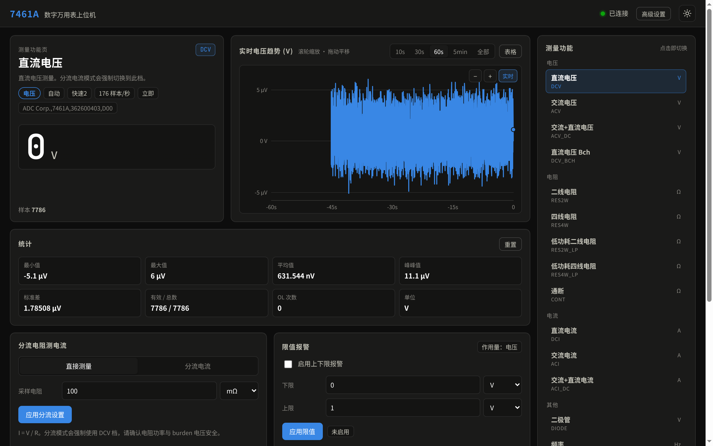
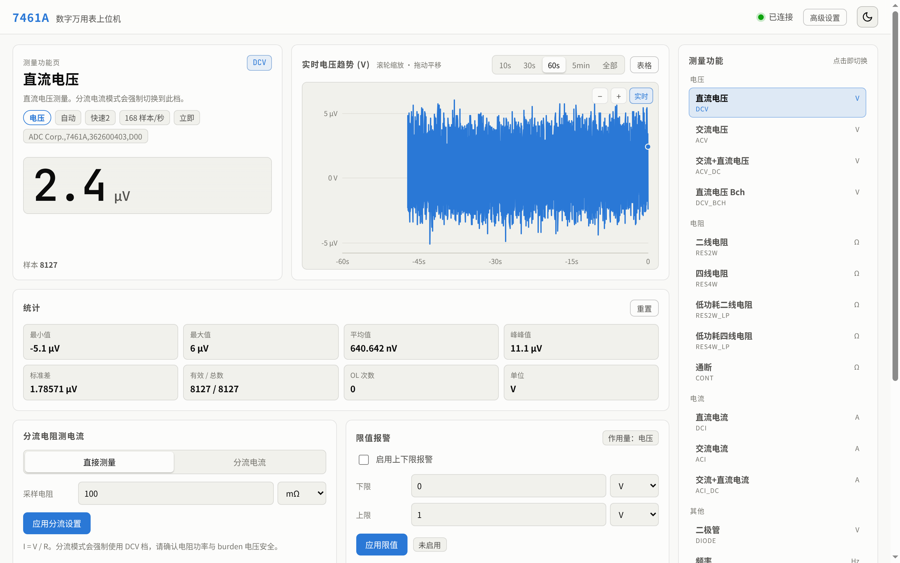
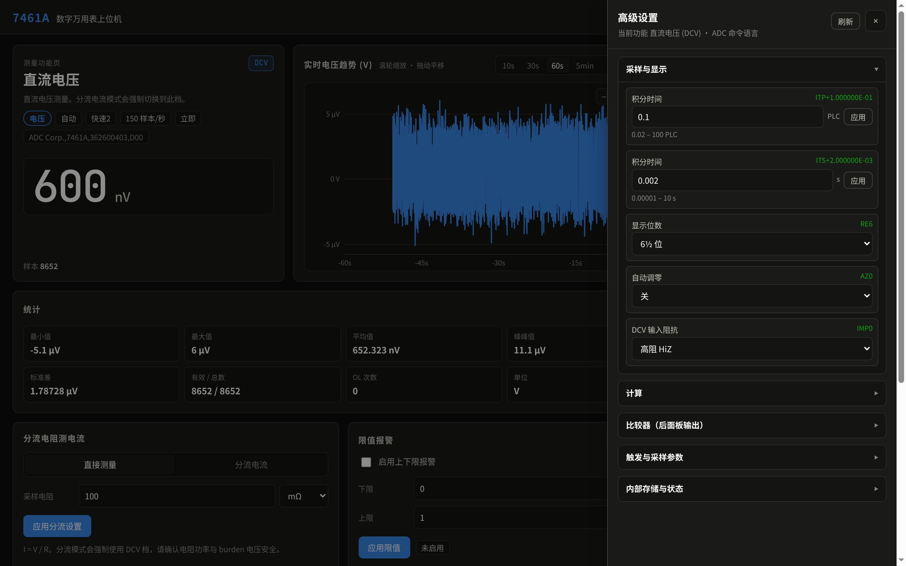

# ADCMT 7461A 网页上位机

基于 **Python + Flask** 的 ADCMT 7461A 六位半数字万用表网页上位机。通过 USB USBTMC
直接控制仪器，在浏览器中提供实时大数字读数、趋势曲线、统计、仪器控制、限值报警与 CSV 记录，
并支持**分流电阻测电流**（输入采样电阻 R，用 DCV 档测电压后实时计算 `I = V / R`）。

网页默认监听 **7461 端口**，中文界面，提供仪器风深色/浅色双主题。

## 界面预览

| 深色主题 | 浅色主题 |
| :---: | :---: |
|  |  |



## 功能特性

- **实时读数**：大数字显示，自动工程单位（µV/mV/V、µA/mA/A、Ω/kΩ/MΩ、Hz），超量程显示 `OL`
- **趋势曲线**：10s / 30s / 60s / 5min / 全部时间窗，自动缩放，十字光标，OL 断线，
  限值虚线，可切换表格视图
- **曲线缩放/平移**：滚轮缩放时间轴（以鼠标位置为中心）、按住拖动平移、双击或点「实时」
  回到实时；图表右上角也提供 `−` / `+` / `实时` 按钮
- **可配置统计信息**：默认显示最小值、最大值、平均值、峰峰值、样本标准差、RMS、中位数、
  趋势斜率、有效/总样本数、OL 次数与比例；点击「设置」可从 24 项中任意增删，包括总体标准差、
  方差、MAD、平均绝对偏差、波峰因数、总和、首末值、极值时间、采样率、统计时长等，
  配置保存在浏览器中；支持「恢复默认」「全选」
- **功能页一键切换**：右侧「测量功能」栏每个功能对应一个页签（DCV / ACV / 2W / 4W / DCI /
  ACI / AC+DC / 二极管 / 通断 / 频率等），点击即切换并显示对应功能页，无需下拉菜单或「应用」按钮
- **量程 / 速率 / 触发**：选中立即生效，界面显示仪器回读值；仪器不接受时提示实际值
- **采样速度可调**：快速1/2、中速、慢速1/2，实测约 **182 / 93 / 18 / 4 / 2 样本/秒**
  （对应积分时间 0.02 / 0.1 / 1 / 5 / 10 PLC）；界面实时显示实际样本速率，高速档自动节流渲染
- **任意积分时间**：右侧控制栏可直接输入积分时间（PLC 或秒，0.02–100 PLC / 0.00001–10 s），
  应用后仪器切换为 PR0 自由采样，界面显示当前 ITP/ITS 回读
- **高级设置**：覆盖 USB 模式下全部可编程功能，包括积分时间、显示位数、AC 滤波、自动调零、
  DCV 输入阻抗、通断阈值、NULL 相对值、平滑、缩放、dB、MAX/MIN、比较器、触发与采样参数、
  内部存储计数与状态寄存器
- **面板优先 / 双向控制**：上位机平时保持 REN 撤销，面板按键始终可用；每次网页命令会临时
  使能远程、执行后自动退回本地，**无需「释放/恢复」操作**。功能/单位通过数据表头即时同步，
  量程/速率/触发每 10 秒自动同步一次，也可点「刷新状态」立即同步
- **高采样性能**：服务端按 10Hz 批量推送样本、图表/读数限帧、可见区间二分查找、扩展统计降采样，
  200 样本/秒时服务端 CPU 约 1–2%，避免高速采集拖慢电脑
- **分流测电流**：输入采样电阻（Ω / mΩ），自动强制 DCV 档，显示电流与 burden 电压
- **限值报警**：软件比较器，超出上下限时读数变红并提示「高于上限/低于下限」，曲线上同步绘制限值线
- **数据记录**：一键开始/停止，CSV 记录功能、单位、原始读数、分流计算电流、显示值、
  报警状态和原始报文，可直接在网页下载
- **双主题**：深色/浅色切换并记忆
- **断线重连**：设备拔插后自动重新打开、重新发送 REN 并使能命令
- **模拟器**：`DMM_SIM=1` 无硬件运行，可注入 OL / 断开故障

## 目录结构

```
.
├── app.py                 # Flask 路由、SSE、统计、报警、CSV 记录
├── dmm7461a.py            # USBTMC 驱动（REN、命令、解析、worker、模拟器）
├── requirements.txt
├── README.md
├── docs/
│   ├── images/            # README 截图
│   └── manuals/           # 官方英文/日文操作手册（PDF）
├── templates/index.html
├── static/app.js
├── static/style.css
├── data/                  # 运行时生成
│   ├── settings.json      # 分流/限值等设置
│   └── logs/              # CSV 记录
└── tests/
```

## 手册

ADCMT（ADC Corporation）官方操作手册放在 `docs/manuals/`，三款机型（7451A / 7461A / 7461P）共用：

| 语言 | 文件 | 手册编号 / 页数 |
| :---: | :--- | :--- |
| 英文 | [Operation Manual](docs/manuals/ADCMT_7451A_7461A_7461P_Operation_Manual_EN_FOE-00000061B01.pdf) | FOE-00000061B01，218 页 |
| 日文 | [取扱説明書](docs/manuals/ADCMT_7451A_7461A_7461P_取扱説明書_JA_FOE-00000060B00.pdf) | FOJ-00000060B00，212 页 |

来源：ADC 官方下载页 <https://www.adcmt.com/en/products/dmm/7451> / <https://www.adcmt.com/products/dmm/7451>。
ADC 只提供英文和日文原版，**没有官方中文手册**；中文资料仅有经销商的产品参数页。

## 快速开始

系统要求：Linux（内核 usbtmc 支持）、Python 3.10+、可访问 `/dev/usbtmc0`。

```bash
cd ~/project/controler_7461A
python3 -m venv .venv
.venv/bin/pip install -r requirements.txt
.venv/bin/python app.py
```

浏览器打开 <http://127.0.0.1:7461>。

虚拟环境位于项目目录内（`./.venv`），依赖与其他项目隔离；`.venv/` 已在 `.gitignore`
中排除，不会被提交。请始终使用 `.venv/bin/python` 启动。

```bash
# 允许局域网访问
HOST=0.0.0.0 .venv/bin/python app.py

# 更换端口
PORT=7462 .venv/bin/python app.py

# 无硬件模拟器
DMM_SIM=1 .venv/bin/python app.py
```

> 系统里 `~/.local` 的 Flask 可能缺少 MarkupSafe，请务必使用项目内 `.venv`。

## 设备与权限

设备节点为 `/dev/usbtmc0`，需要当前用户属于 `dialout` 组。本机已配置 udev 规则：

```
/etc/udev/rules.d/99-usbtmc.rules
SUBSYSTEM=="usbmisc", KERNEL=="usbtmc*", GROUP="dialout", MODE="0660"
```

换机器时创建该文件后重新插拔 USB，并确认：

```bash
ls -l /dev/usbtmc0        # 应为 root:dialout 0660
id                        # 包含 dialout
```

驱动自检：

```bash
.venv/bin/python dmm7461a.py --selftest
```

应输出 `REN` 成功后的 `ADC Corp.,7461A,...`、功能/量程/速率/触发，以及约 20 个/秒的样本。

## 使用说明

1. **功能页切换**：在右侧「测量功能」栏点击任意功能页签，仪器立即切换，主区域显示该功能页
   （功能名称、说明、单位、量程/速率/触发）。切换功能会自动清空当前曲线和统计，避免不同功能
   数据混在一起。
   **曲线操作**：滚轮缩放时间轴，按住拖动平移，双击图表或点「实时」按钮回到实时跟随；
   缩放后标题旁会显示「已缩放」提示，时间轴切换为时钟时间。
2. **直接测量**：默认模式，网页显示仪器当前功能的读数（电压 V、电流 A、电阻 Ω、频率 Hz）。
3. **分流电流**：点击「分流电流」，填写采样电阻（例如 0.1 Ω 或 100 mΩ），应用后自动切到
   DCV 档，显示 `I = V / R`，单位自动换算为 µA/mA/A。分流模式下点击其它功能页签会自动退出
   分流模式。
4. **量程 / 速率 / 触发 / 积分**：下拉框选中即生效；下方「任意积分时间」可输入数值并选择
   PLC 或秒，点「应用」后切换为 PR0 自由采样（0.02–100 PLC 或 0.00001–10 s），顶部显示当前
   ITP/ITS 回读。
5. **双向控制**：上位机平时把仪器交回面板（REN 撤销），面板按键可直接使用；在网页里点击
   功能/量程/速率等会临时接管、执行后自动退回面板，不需要任何「释放/恢复」操作。功能/单位
   通过数据表头即时同步，量程/速率/触发每 10 秒自动同步或点「刷新状态」立即同步。
6. **限值报警**：选择当前显示量的单位（V/mV/µV 或 A/mA/µA），填写上下限并启用。
   电压/电流功能支持软件限值；电阻/频率功能会显示「不支持」。
7. **统计项配置**：点击统计卡右上角「设置」，勾选/取消任意统计项，立即生效并保存在浏览器
   localStorage 中；「恢复默认」「全选」可快速切换。中位数/MAD 基于最近 10000 个样本计算。
8. **数据记录**：点「开始记录」，停止后可在「历史文件」中下载 CSV。
9. **高级设置**：右上角「高级设置」打开抽屉，按分组提供 ADC 命令语言的其余功能：
   - **采样与显示**：积分时间（PLC / 秒）、显示位数（3½–6½）、AC 滤波、自动调零、
     DCV 输入阻抗、通断阈值
   - **计算**：NULL（含「取当前读数」）、平滑及次数、缩放常数 A/B/C、dB/dBm、MAX/MIN 及读回
   - **比较器**：HIGH/LOW 常数、取当前读数、PASS 判定设置（后面板比较器输出）
   - **触发与采样参数**：触发源、手动触发、采样间隔、触发延时/次数、采样次数、预触发、
     单次/多次、完成信号宽度、电平/差值触发参数
   - **内部存储与状态**：存储开关、存储数量/范围、清空存储、仪器统计、STB/ESR 状态、*CLS、*RST

   分组展开时才读取当前值；数字项需点「应用」，选择项选中即生效；所有设置均显示仪器回读值。
10. **主题**：右上角太阳/月亮按钮切换并记住选择。

### 分流测电流安全提示

- 确认采样电阻的**功率额定值**：`P = I² × R`。
- 确认 burden 电压在万用表量程与共模范围内；分流电阻越小，burden 越低但信噪比越差。
- 注意接线位置与接地，避免把地环路引入测量回路。

## 协议说明（重要）

7461A 的 USB 口是标准 USBTMC 类设备，但有两个容易踩的坑：

1. **必须先发送 USB488 REN_CONTROL（远程使能）**。否则仪器停在 LOCAL 状态，只以约 20 次/秒
   连续输出测量数据，完全忽略命令。Linux 内核 usbtmc 驱动不会自动发送，Windows VISA 会。
   本项目通过 `USBTMC_IOCTL_CTRL_REQUEST` 发送：`bmRequestType=0xA1, bRequest=0xA0, wValue=1`，
   成功返回 `0x01`。
2. **USB 模式只支持 ADCMT ADC 命令语言**（SCPI 仅 GPIB 可用），命令以 `\n` 结尾，查询后
   至少等待 20ms 再读；测量数据与查询应答共用读取流。超量程值为 `+9.999999E+37`。

驱动打开设备后的流程：`CLEAR → REN → H1 → *IDN? → F? / R? / PR? / TRS?`。

## 故障排查

| 现象 | 处理 |
|---|---|
| 页面显示「设备未连接」 | 检查 USB 线、接口是否设为 USB 模式（MENU → 8 I/F → BUS → USB）、`ls -l /dev/usbtmc0` |
| `无权限访问` | 用户不在 `dialout` 组或未重新登录；检查 udev 规则 |
| 显示连接但命令不生效 | 确认 REN 状态字节为 0x01；重插 USB 或点「刷新状态」；查看服务端日志 |
| 内核日志刷 `invalid notification: 0` | 该表固件的 USBTMC 通知端点小问题，不影响命令与读数，可忽略 |
| 端口 7461 被占用 | `ss -ltnp \| grep 7461`，或 `PORT=7462` 启动 |
| CSV 无数据 | 需先成功连接设备再「开始记录」；检查 `data/logs/` 写权限 |
| 读数一直 OL | 输入过载/开路，检查接线与量程 |

## 测试

```bash
.venv/bin/python -m unittest discover -s tests -v
```

覆盖解析、OL 判定、ioctl 常量、统计、分流换算、API、CSV 导出与路径穿越防护。

## 已知限制

- USB 模式下没有 SCPI，只有 ADC 命令语言；本项目已封装全部测量功能与主要可编程设置。
- 采样率由仪器决定（随 `PR`/积分时间变化，约 2–182 次/秒）；网页按实际数据流显示并限速渲染。
- **MAX/MIN/AVE 读回需先开启「MAX/MIN 计算」（MN1）**；**NULL 常数在 NULL 关闭时无效**，
  「取当前读数」会同时打开 NULL。
- 内部存储的**原始数据回读**（IRD/IRO）和统计范围（SIRD）未做成界面操作；需要长时间记录时
  请使用本软件的 CSV 记录功能。
- **手动/外部/总线/电平/差值触发等待期间，仪器固件不应答任何查询**：网页无法读取或同步该模式下
  由面板造成的改动；通过网页设置这些触发模式会按设定值显示，切回「立即」触发即恢复同步与数据流。
- 面板优先模式下，网页命令执行期间或每 10 秒同步的数百毫秒内仪器会短暂处于远程；此时按下的
  面板按键可能被忽略，再按一次即可。
- 自动量程切换瞬间可能出现短暂异常值，属于仪器行为。

## 开发诊断

验证「面板外部改动同步」时，可使用开发模式：

```bash
DMM_DEV=1 .venv/bin/python app.py
curl -X POST -H 'Content-Type: application/json' \
     -d '{"command":"F1"}' http://127.0.0.1:7461/api/dev/raw
```

该接口直接发送 ADC 命令且不更新内部状态，可用来模拟面板按键改动；正常运行时不要设置 `DMM_DEV=1`。
